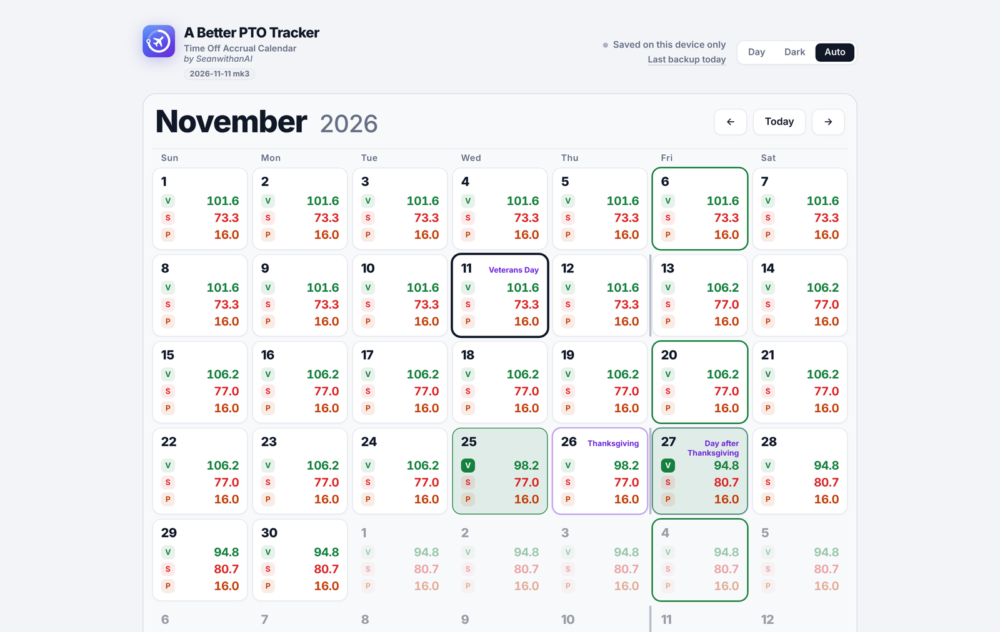
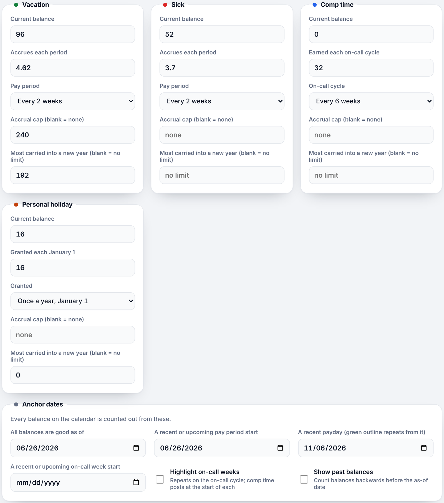

# A Better PTO Tracker

**Time Off Accrual Calendar: see what every day off will cost you before you book it**

*by SeanwithanAI*

---

## Overview

A Better PTO Tracker is a calendar that shows what each of your time-off **banks** will be worth on any date: **vacation, sick, comp time and personal holiday**. Book a day or half day and every future balance updates instantly, so you can plan a trip without running a bank negative. It's all in one HTML file, with nothing to install and no sign-up.

## Features

- **Four banks, each with its own rules.** Starting balance, how much accrues each pay period, an accrual cap, and the most you can carry into a new year.
- **Flexible schedules.** Accrue weekly, every 2 weeks, monthly or yearly. Comp time is earned per on-call cycle (for example, every 6 weeks), and personal holiday is granted each January 1.
- **A balance on every day.** Each calendar day shows the projected balance of every bank. Red means a bank has gone negative.
- **One-tap booking.** Pick a bank, tap a day to spend it, or turn on **½ day** (or Shift-click) for a half day. **Clear day** wipes a date.
- **Paydays and pay periods.** Paydays are outlined in green, and a thin marker shows where each pay period starts.
- **Holidays.** Choose a schedule (City, State, Federal, Private Sector, and more) or add your own. Change which holidays are in any schedule; your edits are saved with your data, not the app, and **Reset this schedule** puts it back. Holidays are labels only and never change the math.
- **Vacation incentive.** Earn extra hours on January 1 for using little sick leave the year before. The default: 8 or fewer sick hours used earns 8 vacation hours, up to 16 earns 6, up to 20 earns 4. Edit the rows, pick which bank it's based on and which it pays into, or add your own incentives. A milestone bar starts full at 0 hours used and shrinks as you use sick time, with a green 😊 message showing what you're on track to earn (or a red ☹️ one if you won't get anything). On January 1 a popup asks before adding the hours to your balance. Saved with your data.
- **On-call weeks.** These can be highlighted; comp time posts at the start of each one.
- **Year-end rules.** On January 1, anything above a bank's carryover limit is dropped automatically.
- **Hours or days.** Count balances in hours or days, with your own length of a working day.
- **Backup and import.** Download a backup file and restore it on any device.
- **Day, Dark and Auto** themes.

## Screenshots

| Calendar | Bank settings |
|---|---|
|  |  |

Screenshots use made-up example data.

## Getting started

1. Open `A-Better-PTO-Tracker-<date>-<mk>.html` in any modern browser, or open it from **PageVault**.
2. Under each bank, enter your **current balance**, how much you **accrue each period**, and any **cap** or **carryover limit**.
3. Under **Anchor dates**, set the date your balances are good as of, a recent pay-period start, and a recent payday.
4. Pick a **holiday schedule**, then start booking days off on the calendar.

## Where your data is stored

| Opened from… | Saved to | Status shown in the app |
|---|---|---|
| **PageVault** | Your own server only, separately for each signed-in person. Nothing is kept in the browser. | *Saved to your server* |
| **A local file** | This browser only. The app reminds you every 7 days to download a backup. | *Saved on this device only* |

## Versioning

Every release is a new file named with the release date. The first release of a day is just the date; later releases that same day add `mk1`, `mk2`, `mk3`… (the count starts over each day), e.g. `A-Better-PTO-Tracker-2026-11-12.html`, then `A-Better-PTO-Tracker-2026-11-12-mk1.html`. The version also appears under the app's name. Older files usually stay in the repo, so PageVault can roll back to them.

| Version | Notes |
|---|---|
| **2026-11-14** | Behind-the-scenes cleanup of the City holiday schedule; your saved schedule and edits carry over. Older release files were removed from the repo. |
| **2026-11-13** | Version bump only, no changes. |
| **2026-11-12 mk1** | Vacation incentive: milestone bar of the year's sick hours used (full at 0, shrinking as you use time, with ticks where the reward drops), green 😊 / red ☹️ message for what you'll get in January, and a January 1 popup asking whether to add the hours to your existing balance (Yes / No / Ask me later, with Undo in the tile). |
| **2026-11-12** | New **Vacation incentive** tile next to Personal holiday: hours earned on January 1 based on sick leave used the year before (default chart: ≤8 hrs → 8, ≤16 → 6, ≤20 → 4), fully editable, with your own incentives. Holiday schedules renamed to **City** and **State**, and every schedule can now be edited; edits are saved with your data. |
| **2026-11-11 mk4** | Shows where data is saved: *Saved to your server* in PageVault (no backup reminders there), *Saved on this device only* elsewhere. The last edit is now saved even if the page is closed right away. |
| **2026-11-11 mk3** | Previous release |

---

A Better PTO Tracker · Time Off Accrual Calendar · by SeanwithanAI · private repository

