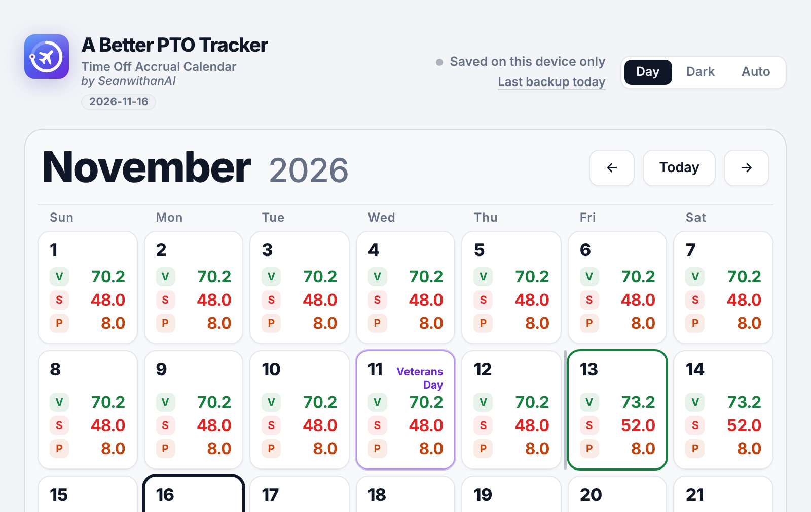
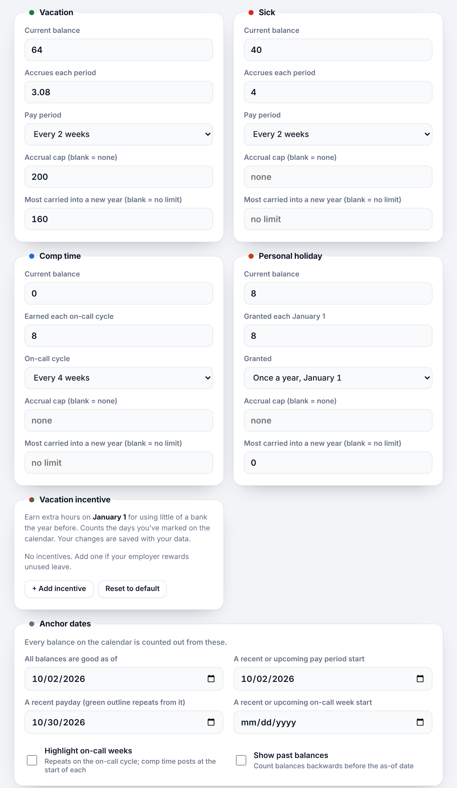

# A Better PTO Tracker

**Time Off Accrual Calendar: see what every day off will cost you before you book it**

**[▶ Open it online](https://seanwithanai.github.io/A-Better-PTO-Tracker/)** · nothing to install · your data stays on your device

*by SeanwithanAI*

---

## Overview

A Better PTO Tracker is a calendar that shows what each of your time-off **banks** will be worth on any date: **vacation, sick, comp time and personal holiday**. Book a day or half day and every future balance updates instantly, so you can plan a trip without running a bank negative. It's all in one HTML file, with nothing to install and no sign-up.

## Features

- **Four banks, each with its own rules.** Starting balance, how much accrues each pay period, an accrual cap, and the most you can carry into a new year.
- **Flexible schedules.** Accrue weekly, every 2 weeks, monthly or yearly. Comp time is earned per on-call cycle (every 4 to 9 weeks), and personal holiday is granted each January 1.
- **A balance on every day.** Each calendar day shows the projected balance of every bank. Red means a bank has gone negative.
- **One-tap booking.** Pick a bank, tap a day to spend it, or turn on **½ day** (or Shift-click) for a half day. **Edit day** lets you type exact hours (like 2.5) for a date. **Clear day** wipes a date.
- **Paydays and pay periods.** Paydays are outlined in green, and a thin marker shows where each pay period starts.
- **Holidays.** Choose a schedule (City, State, Federal, Private Sector, and more) or add your own. Change which holidays are in any schedule; your edits are saved with your data, not the app, and **Reset this schedule** puts it back. Holidays are labels only and never change the math.
- **Vacation incentive.** Earn extra hours on January 1 for using little sick leave the year before. The default: 8 or fewer sick hours used earns 8 vacation hours, up to 16 earns 6, up to 20 earns 4. Edit the rows, pick which bank it's based on and which it pays into, or add your own incentives. A milestone bar starts full at 0 hours used and shrinks as you use sick time, with a green 😊 message showing what you're on track to earn (or a red ☹️ one if you won't get anything). On January 1 a popup asks before adding the hours to your balance. Saved with your data.
- **On-call weeks.** These can be highlighted; comp time posts at the start of each one.
- **Year-end rules.** On January 1, anything above a bank's carryover limit is dropped automatically.
- **Hours or days.** Count balances in hours or days, with your own length of a working day.
- **Backup and import.** Download a backup file and restore it on any device.
- **Day, Dark and Auto** themes.
- **Download app + data.** In Settings, one click downloads a .zip with this version of the app, a backup of your data, and a short note on how to restore it. Open the HTML anywhere and restore the backup to pick up where you left off. In PageVault it's the exact file that's installed.

## Screenshots

| Calendar | Bank settings |
|---|---|
|  |  |

Screenshots use made-up example data.

## Getting started

1. Open `A-Better-PTO-Tracker-<date>-<mk>.html` in any modern browser, or open it from **PageVault**.
2. Under each bank, enter your **current balance**, how much you **accrue each period**, and any **cap** or **carryover limit**.
3. Under **Anchor dates**, set the date your balances are good as of, a recent pay-period start, and a recent payday.
4. Pick a **holiday schedule**, then start booking days off on the calendar.

## Opening the file on your devices

**Easiest: the web link.** Open **[seanwithanai.github.io/A-Better-PTO-Tracker](https://seanwithanai.github.io/A-Better-PTO-Tracker/)** on any phone, tablet or computer. It's this same app, served by GitHub, and it always has the newest version. Nothing is sent anywhere: your data is saved in that browser on that device, just like the downloaded file. On iPhone or iPad, open it in Safari, tap **Share** (on iOS 26 and later, tap **•••** first), then **Add to Home Screen** to keep it like an app. On Android, use Chrome's **⋮ → Add to Home screen**.

Prefer to keep your own copy of the file? The steps below cover that.

The app is one self-contained `.html` file: no install, no account, nothing else to download. Download `A-Better-PTO-Tracker-<date>.html`: open it in the file list above, then use the **Download raw file** button (↓) at the top right of the file view.

**Desktop (Windows, macOS, Linux)**
1. Download the file and move it somewhere permanent, like Documents.
2. Double-click it. It opens in your default browser (Chrome, Edge, Firefox, Safari and Brave all work).
3. Bookmark it, and always open it the same way: same file, same place, same browser. Your data is saved in that browser for that file, so a copy in another folder or another browser starts empty.

**iPhone and iPad**
**Because of iOS, an HTML file saved on your iPhone or iPad can't be opened in Safari.** iOS doesn't offer Safari as a way to open it, and tapping the file in the Files app only shows a preview with the buttons turned off. Use one of these instead:
- **The web link (recommended).** See above.
- **PageVault.** Open the app's PageVault link in **Safari**, then tap **Share** (on iOS 26, tap **•••** first, then **Share**). Scroll down the list and tap **Add to Home Screen**. If it isn't there, tap **Edit Actions** at the bottom of the list and add it. It then opens like a regular app, and your data is saved on your server and syncs with your other devices.
- **Microsoft Edge (may work).** Save the file to the Files app, then try opening it with Edge (in Files, open the file, tap **Share** and choose **Edge**). Keep backups: data saved this way can be lost if Edge clears its storage.

**Android**
1. Download the file in Chrome.
2. Open it from Chrome: **⋮ → Downloads** and tap the file (or from the Files app, **Open with → Chrome**).
3. Open it from Chrome's Downloads each time. A home-screen shortcut to a downloaded file may stop working after Chrome restarts.
4. Turn on backups (the app reminds you every 7 days), or use **PageVault** and **⋮ → Add to Home screen** so your data lives on your server instead.

**Moving to another device:** download a backup in the app, open the same version on the new device, and restore the backup there. With PageVault there's nothing to move.

## Where your data is stored

| Opened from… | Saved to | Status shown in the app |
|---|---|---|
| **PageVault** | Your own server only, separately for each signed-in person. Nothing is kept in the browser. | *Saved to your server* |
| **A local file** | This browser only. Saved in the browser's large storage, with room for years of data; the app asks the browser to keep it rather than clear it to free up space. The app reminds you every 7 days to download a backup. | *Saved on this device only* |

## Versioning

Only the newest release is kept in the repo: `A-Better-PTO-Tracker-2026-11-17-mk1.html`. Each new release replaces it, and `docs/index.html` (what the web link opens) is updated to match. Your data isn't stored in the file, so moving to a new release keeps it (if you use the downloaded file, open the new one the same way as before, in the same browser, and download a backup first to be safe).

Releases are named with their date. The first release of a day is just the date; later releases that same day add `mk1`, `mk2`, `mk3`… (the count starts over each day). The version is also shown inside the app.

### Changelog

Every release so far, newest first. Older releases are listed for reference; only the current one is available to download.

| Version | Notes |
|---|---|
| **2026-11-17 mk1** | **Edit day** sets exact hours off on a date (like 2.5 hours for an appointment). Turn it on, pick a bank, and tap a day: a panel slides up with a number box, **½ day** and **full day** shortcuts, and **Remove** if something's already booked. The **½ day** button still works as before. Odd amounts show next to the balance on the calendar (for example **2.5h**). Days booked with older versions don't change. The version shown inside the app now matches the release. |
| **2026-11-17** | Comp time's on-call cycle can now be set to **every 8 weeks** or **every 9 weeks**, alongside 4 to 7. |
| **2026-11-16 mk5** | PageVault save status is accurate: a change on its way now shows **Saving to your server…** instead of briefly saying **Can't reach your server**, which only appears if a change still hasn't gone through after 10 seconds. |
| **2026-11-16 mk4** | **Room to grow.** Opened on its own, the app now keeps its data in the browser's large storage (IndexedDB) instead of the small save area (about 5 MB, shared with every page on the same site), so a big history never runs out of room. Your data moves over automatically the first time you open this version. The app asks the browser to keep its data, and says so plainly if the browser ever can't save. In PageVault nothing changes. (An older copy of the file opened afterwards won't see data saved by this version, so use this one or newer.) |
| **2026-11-16 mk3** | **Use it online.** The app now has a web link, [seanwithanai.github.io/A-Better-PTO-Tracker](https://seanwithanai.github.io/A-Better-PTO-Tracker/), that works on any device, including iPhone and iPad, and always has the newest version. The preview shown when the file can't run points to it. |
| **2026-11-16 mk2** | The preview now says plainly that, because of iOS, an HTML file saved on an iPhone or iPad can't be opened in Safari, and points to PageVault instead. |
| **2026-11-16 mk1** | The preview shown when the file can't run (like in the iPhone Files app) now explains how to open it on a computer, Android, iPhone and iPad. |
| **2026-11-16** | Neutral defaults for new installs (no built-in payday or carry-over limit, a 4-week comp cycle) and the State holiday schedule has a new internal name. Your saved settings and holiday schedule carry over unchanged. |
| **2026-11-14 mk2** | **Download app + data (.zip)** replaces Download this app: one click gives a zip with the app's HTML, your backup and a how-to-restore note. |
| **2026-11-14 mk1** | **Download this app** in settings (next to Back up and Import): the HTML file for this version, to keep or run on its own. |
| **2026-11-14** | Behind-the-scenes cleanup of the City holiday schedule; your saved schedule and edits carry over. Older release files were removed from the repo. |
| **2026-11-13** | Version bump only, no changes. |
| **2026-11-12 mk1** | Vacation incentive: milestone bar of the year's sick hours used (full at 0, shrinking as you use time, with ticks where the reward drops), green 😊 / red ☹️ message for what you'll get in January, and a January 1 popup asking whether to add the hours to your existing balance (Yes / No / Ask me later, with Undo in the tile). |
| **2026-11-12** | New **Vacation incentive** tile next to Personal holiday: hours earned on January 1 based on sick leave used the year before (default chart: ≤8 hrs → 8, ≤16 → 6, ≤20 → 4), fully editable, with your own incentives. Holiday schedules renamed to **City** and **State**, and every schedule can now be edited; edits are saved with your data. |
| **2026-11-11 mk4** | Shows where data is saved: *Saved to your server* in PageVault (no backup reminders there), *Saved on this device only* elsewhere. The last edit is now saved even if the page is closed right away. |
| **2026-11-11 mk3** | Previous release |

A Better PTO Tracker · Time Off Accrual Calendar · by SeanwithanAI

